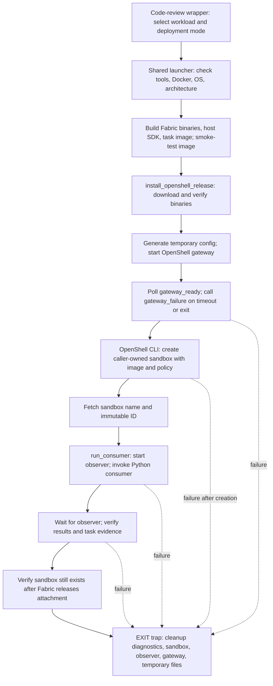
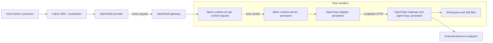

<!--
SPDX-FileCopyrightText: Copyright (c) 2026, NVIDIA CORPORATION & AFFILIATES. All rights reserved.
SPDX-License-Identifier: Apache-2.0
-->

# OpenShell code-review demo function flow

The NVIDIA NeMo Fabric example has two launchers. [The code-review wrapper](run-demo.sh) selects `OPENSHELL_EXAMPLE_WORKLOAD=code-review` and `OPENSHELL_EXAMPLE_MODE=deployment`, then uses `exec bash` to replace itself with [the shared launcher](../../langgraph_openshell/run-demo.sh). The wrapper does not provision or run an agent itself.

## Launcher flow

The shell runs its top-level statements in order; there is no shell `main()` function. The `EXIT` trap is installed before builds and gateway startup, but after dependency checks, architecture detection, and creation of temporary directories.

| Function or block | What it does |
| --- | --- |
| Workload selection | Chooses the code-review image and policy, and the non-secret placeholder key for the local inference server. Rejects code-review development mode. |
| `normalize_arch()` | Maps host and Docker daemon architecture names to supported release asset names. |
| Build block | Builds `fabric-runtime-server`, `fabric-runtime-ctl`, and the OpenShell provider; installs the host SDK in a dedicated checkout-local virtualenv; stages adapter packages and example assets; builds the image and records its image ID. |
| Image smoke check | Checks adapter import, sample repository and skill presence, writable artifacts, and Node/OpenClaw version output in an ordinary container. The subsequent live run tests the OpenShell policy boundary. |
| `download_release_asset()` | Downloads a missing asset into the checkout cache, using a temporary `.part` file. |
| `verify_release_asset()` | Checks an asset against its published SHA-256 checksum list. |
| `ensure_release_asset()` | Downloads and verifies an asset; redownloads an invalid cached asset. |
| `install_openshell_release()` | Fetches checksum lists, verifies the CLI/gateway/supervisor archives, and extracts them into the cache's `bin` directory. |
| Gateway startup block | Generates signing material, writes temporary gateway configuration, and starts a loopback gateway using the Docker driver. The demo disables gateway TLS and authentication. |
| `gateway_ready()` | Checks whether the gateway TCP port accepts a connection. This is a readiness probe, not a model or sandbox health test. |
| `gateway_failure()` | Prints a failure and the gateway log tail, then exits through the cleanup trap. |
| Deployment block | Uses the OpenShell CLI to create a sandbox with the image and creation-time policy. The sandbox's main command is `fabric-runtime-server serve`. Retrieves its immutable ID before calling `run_consumer()`. |
| `run_consumer()` | Starts the task observer, generates a unique review label, and invokes the existing Python code-review entry point with two inputs and OpenShell configuration. Waits for the observer and validates success, runtime identity, label recall, process identities, session turn count, and a `calculator.py` read call. |
| Ownership check | Uses the OpenShell CLI to confirm that Fabric's release left the caller-owned sandbox intact. |
| `cleanup()` | Preserves selected task/gateway diagnostics; requests deletion of the caller-owned sandbox; stops the observer and temporary gateway; removes staging and gateway-state directories. Reports sandbox deletion failure and preserves the failure exit status. Download caches, image layers, the host virtualenv, and evidence remain. |

The shared launcher's default workload is the LangGraph courier. Its optional development branch calls a different consumer, which uses Fabric-owned environment creation and release. The code-review wrapper always selects the caller-owned deployment branch.

## Python consumer and runtime flow

The shell's `run_consumer()` launches [the existing code-review entry point](../__main__.py). Its `main()` builds the OpenClaw configuration, applies model and CLI overrides, and calls [`with_openshell()`](../config.py). This composition selects image-provided adapter resolution, the task workspace, the task skill path, the OpenShell gateway, and caller-owned attachment.

`_review_turns()` then executes:

1. `Fabric.attach_environment(config, reference)`: attach to the sandbox identified by name and immutable ID.
2. `Fabric.start_runtime_in(config, environment)`: create the task-side adapter session and start its managed OpenClaw Gateway.
3. `runtime.invoke(input=review)`: send the first request. OpenClaw reads workspace/skill files and calls the external model endpoint from inside the sandbox.
4. `runtime.invoke(input=follow_up)`: send a separate request to the same runtime. The host supplies the new question without replaying the first prompt or response.
5. In `finally`, `runtime.stop()`, followed by `Fabric.release_environment(environment)` in a nested `finally`. Startup failure still releases a successful attachment; stop failure still attempts release.

Normalized failure results end the invocation loop early. Transport/lifecycle exceptions propagate after cleanup. Successful results are written to the host's `--results-file`; the task's temporary OpenClaw state is removed during runtime shutdown.

The execution path is:

The observer is separate test instrumentation. It polls task process identities and the pinned OpenClaw session database while the runtime is alive, exporting read-call paths and session counts. It does not drive the agent or call the model. The host reads its evidence after the two turns complete.

## What Fabric supplies versus what the demo supplies

| Owner | Responsibility |
| --- | --- |
| Fabric | Configuration projection, adapter selection, environment attachment, task runtime lifecycle, ordered invocation transport, normalized results, and release semantics. |
| Existing OpenClaw adapter/harness | OpenClaw configuration and process lifecycle, agent loop, tool execution, model calls, and conversation/session state. |
| OpenShell | Sandbox creation/execution, filesystem and network policy enforcement, and sandbox deletion. |
| Demo/deployment script and image | Dependency packaging, gateway bootstrap, workspace and skill provisioning, model-route policy, model-access provisioning, caller-owned sandbox creation/deletion, and acceptance evidence. |

The current evidence supports the pitch: **Fabric runs an existing agent through one lifecycle API inside a prepared sandbox, without adding sandbox logic to its agent loop.** The supplied deployment is a one-command example. General turnkey deployment would additionally require reusable image/provisioning support and configurable workspace, skill, model-policy, and credential inputs beyond this fixed example.
