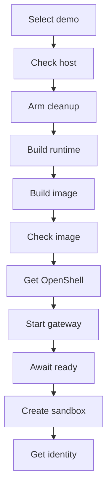
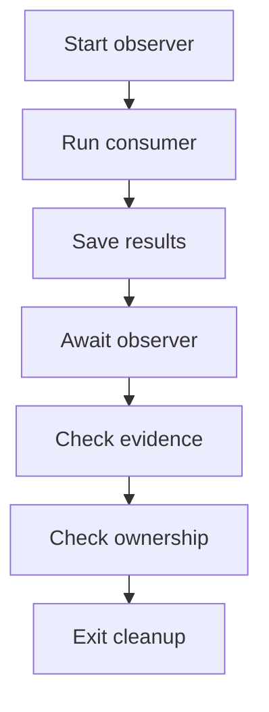
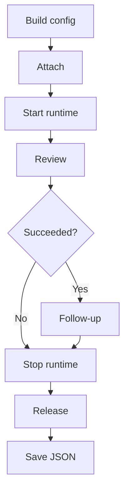
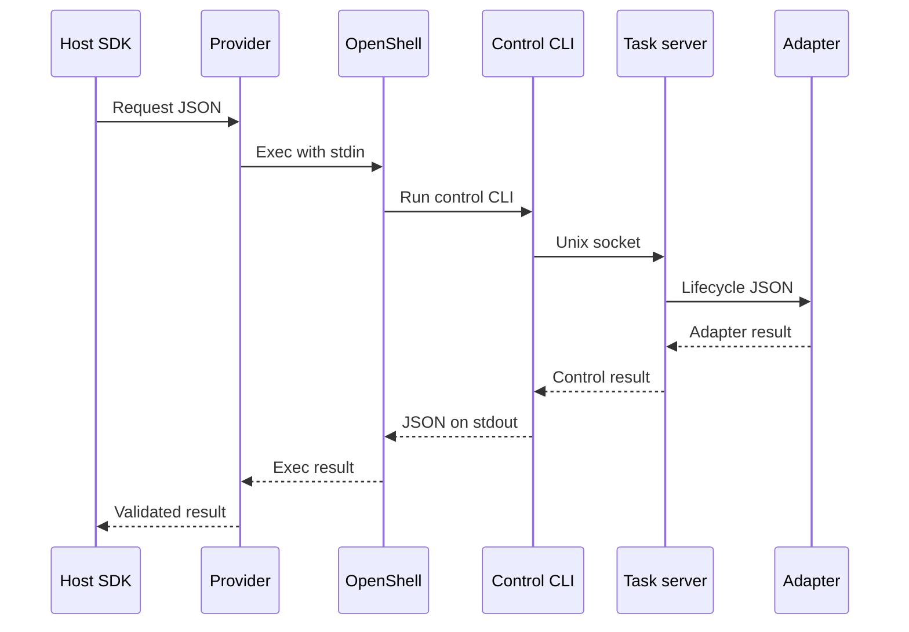
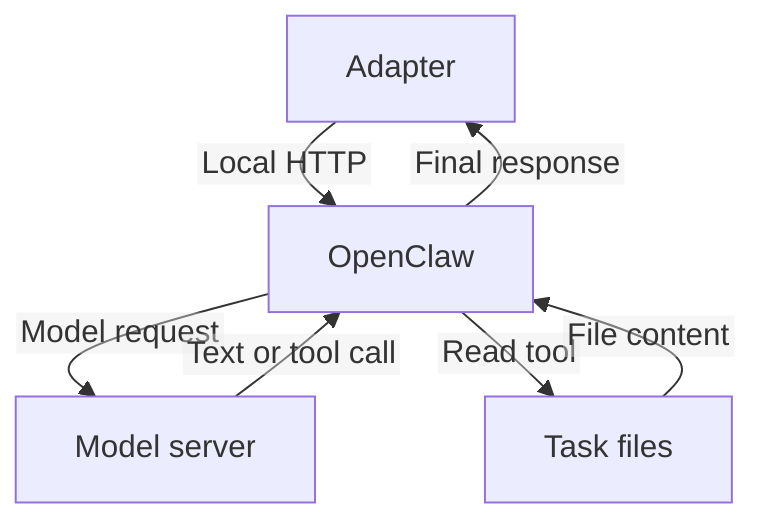

<!--
SPDX-FileCopyrightText: Copyright (c) 2026, NVIDIA CORPORATION & AFFILIATES. All rights reserved.
SPDX-License-Identifier: Apache-2.0
-->

# OpenShell code-review demo function flow

This document follows the current NVIDIA NeMo Fabric **OpenClaw** demo from its shell entry point to task execution and cleanup. Hermes is a proposed extension; these scripts do not yet support it. The diagrams use short labels; the text and tables supply the exact commands and function names.

## 1. Select the workload and prepare the deployment

[The code-review wrapper](run-demo.sh) sets `OPENSHELL_EXAMPLE_WORKLOAD=code-review` and `OPENSHELL_EXAMPLE_MODE=deployment`, then replaces itself with [the shared launcher](../../langgraph_openshell/run-demo.sh) using `exec bash`. The shared script executes its top-level statements in order; it has no shell `main()` function.

| Diagram step | Code and handoff |
| --- | --- |
| Select demo | Choose the OpenClaw Dockerfile and policy, the local inference placeholder key, and caller-owned deployment mode. The wrapper's `EXAMPLE_ROOT` names its directory; the shared script computes its own roots when it starts. |
| Check host | Check Cargo, curl, Docker, Python, tar, and uv. Create temporary directories. `normalize_arch()` maps both host and Docker-daemon architectures to the published OpenShell asset names. |
| Arm cleanup | Register `trap cleanup EXIT`. This occurs after dependency/architecture checks and temporary-directory creation, before the build steps. |
| Build runtime | Build `fabric-runtime-server` and `fabric-runtime-ctl` in release mode, the host OpenShell provider in debug mode, and the host Python SDK in `.tmp/langgraph-openshell-venv`. |
| Build image | Stage the contract/common/OpenClaw adapter packages, binaries, repository, skill, and observer. Docker builds the task image; `docker image inspect` supplies the immutable image ID used for sandbox creation and Fabric attachment. |
| Check image | Run an ordinary container to check adapter import, sample files, writable artifacts, and Node/OpenClaw version output. Save `image-id.txt`. This check precedes OpenShell policy enforcement. |
| Get OpenShell | `install_openshell_release()` obtains and verifies the pinned CLI, gateway, and sandbox-supervisor archives, then extracts them to the checkout cache. |
| Start gateway | Generate signing material and write a temporary `gateway.toml`. Start the OpenShell gateway as a background host process with the Docker driver. This functional demo uses unauthenticated, plaintext loopback access. |
| Await ready | Poll `gateway_ready()` until the TCP port accepts a connection. If the process exits or the deadline expires, `gateway_failure()` prints the gateway log tail and exits. |
| Create sandbox | OpenShell CLI `sandbox create` receives the image ID, policy file, and task environment. The sandbox's main command is `fabric-runtime-server serve`; the agent has not started yet. After creation succeeds, set `SANDBOX_CREATED=yes`. |
| Get identity | OpenShell CLI `sandbox get --output json` retrieves the immutable sandbox ID. Pass the sandbox name and ID to `run_consumer()`. |

The release-install helper calls are: `install_openshell_release()` → `download_release_asset()` for checksum lists → `ensure_release_asset()` for each archive → `download_release_asset()` and `verify_release_asset()`. An invalid cached archive is removed, redownloaded, and verified again before extraction.

## 2. Run the consumer alongside the evidence observer

`run_consumer()` takes over after provisioning. Its code-review branch starts [the task observer](capture_evidence.py) through an OpenShell Exec request, saves its host-side PID for cleanup, and generates a unique public review label. It then launches [the Python consumer](../__main__.py) with gateway/image/identity inputs, model flags, two prompts, and a host results path.

The observer runs **in parallel** with the consumer. It samples task-side PIDs and OpenClaw session-database events before runtime shutdown removes the temporary session state. It exits after seeing the agent processes disappear, or at its deadline, and emits `task-evidence.json`. It drives no agent actions.

The shell waits for the observer only after Python returns successfully. Its acceptance checks require two successful normalized results with the same runtime ID, first-turn label recall, one adapter and one OpenClaw Gateway process identity, two user turns in a session, and a `read` call for `calculator.py`. These checks establish execution/session behavior, not the correctness of every model finding. The observer records attempted read calls, including paths that might not exist.

The ownership check is a separate OpenShell `sandbox get`: the sandbox must still exist after Fabric releases its attachment. Deletion follows in shell cleanup.

## 3. Python lifecycle: attach, start, two turns, stop, release

The consumer's `main()` builds `openclaw_config()`, applies CLI/model overrides, and calls [`with_openshell()`](../config.py). The composition keeps the existing OpenClaw adapter, selects `image_provided` resolution, sets `/sandbox/repos/my-service` as the workspace, maps the default skill to `/opt/nemo-fabric/skills/code-review`, and selects caller-owned attachment. Custom relative skill paths are rejected. The CLI builds an `EnvironmentReference` from the supplied name and immutable ID.

The diagram shows returned results. Exceptions follow the cleanup behavior below.

| API call in `_review_turns()` | What changes |
| --- | --- |
| `Fabric.attach_environment()` | Verify/bind to the existing sandbox. Returns an environment handle; it does not create the sandbox or start the agent. |
| `Fabric.start_runtime_in()` | Allocate a runtime ID and send a start request to the existing task server. The server launches the Python adapter; the adapter creates isolated OpenClaw state/configuration and starts its loopback Gateway. |
| First `runtime.invoke()` | Send the review prompt. OpenClaw executes its agent loop, reads files through tools, and calls the external model from the task environment. |
| Second `runtime.invoke()` | Send only the follow-up to the same runtime. The host does not replay the first prompt or response; OpenClaw retains the conversation in its session state. This call is skipped if the first call returns a failed result. |
| `runtime.stop()` in `finally` | Stop the managed OpenClaw Gateway, remove its temporary state, and end the adapter session. The task runtime server and caller-owned sandbox continue running. |
| `Fabric.release_environment()` in nested `finally` | Release Fabric's attachment. Caller-owned ownership preserves the sandbox. Release is attempted even if stop raises; a successful attachment is released if runtime startup raises. |

Only after `_review_turns()` finishes its cleanup does `main()` write `results.json` and print the normalized results. A returned failed result is also saved, and the consumer exits with status 1. A raised startup/invocation/cleanup exception propagates and bypasses this result-file write; shell diagnostics are then the available failure evidence. If attachment itself fails, there is no returned handle to release.

## 4. How a lifecycle request crosses the sandbox boundary

Every start, invoke, and stop follows the same transport path. The host consumer uses the Python SDK and in-process Rust coordinator. The coordinator sends provider IPC to a separate host OpenShell provider process. The provider verifies sandbox binding and issues generic Exec with `fabric-runtime-ctl start`, `invoke`, or `stop`, passing the request JSON on stdin.

The control CLI is short-lived and forwards to `/sandbox/.fabric/control/runtime.sock`. The server retains the adapter across requests. On start, it launches the adapter before sending the lifecycle JSON; on invoke, it reuses that adapter; on stop, it ends the adapter session. The server speaks adapter-contract JSON over stdin/stdout to the adapter. Response JSON travels back through the control socket and Exec output; the provider checks identities and errors, and Fabric returns a normalized runtime result to Python.

There is one start Exec, two invoke Execs, and one stop Exec on the successful two-turn path. Attachment/release, observer Exec, provisioning, and diagnostic collection are separate operations. The host never connects directly to the sandbox's OpenClaw HTTP endpoint.

Inside the sandbox, the adapter invokes OpenClaw over authenticated loopback HTTP. OpenClaw owns the agent loop and model/tool choices:

The adapter and OpenClaw run in the task sandbox; the model server at `10.86.19.10:8000` is external. OpenShell enforces the filesystem policy and the permitted Node inference route. The image supplies the repository, skill, runtime binaries, and writable directories. Session state is temporary and local to this managed runtime; it is not a promise of restart recovery.

## 5. Exit and failure cleanup

`set -euo pipefail` sends ordinary failing commands to the registered `EXIT` trap. `gateway_failure()` explicitly exits through it. `cleanup()` runs these actions in order:

1. If sandbox creation was recorded, collect selected task OpenClaw diagnostics and copy the host OpenShell gateway log into `.tmp/openclaw-code-review/`. On failure, print the diagnostic tail.
2. Request deletion of the caller-owned sandbox. This also terminates its remaining task processes, including the runtime server. Deletion failure sets the exit status to 1.
3. Stop and reap the host observer Exec client if still tracked.
4. Stop and reap the temporary host OpenShell gateway.
5. Remove image-staging and gateway-state directories, disable the EXIT trap, and exit with the preserved failure status.

Fabric's runtime cleanup and the shell's deployment cleanup are separate: Fabric stops/releases its runtime attachment; the caller's script deletes the sandbox. Cached releases, the host virtualenv, Docker images, and host evidence remain for later runs.

Current limits matter when interpreting failures: the gateway readiness check is TCP-only; the creation marker is set after `sandbox create` succeeds, so a partially failed create is not recorded for deletion; a failed gateway-log copy can also interrupt cleanup under `set -e`. The diagrams describe the intended and tested path, not a guarantee of recovery from every provisioning failure. Model endpoint and policy changes still require coordinated configuration in this POC.

## Ownership and output reference

| Owner | Responsibility |
| --- | --- |
| Fabric | Configuration projection, adapter selection, attachment, runtime control transport, normalized results, and ownership-aware release. The consumer orders the two calls. |
| OpenClaw adapter and harness | Managed harness process lifecycle, agent loop, tools, model calls, and conversation state. |
| OpenShell | Sandbox provisioning/Exec and filesystem/network policy enforcement. |
| Demo/deployment | Image/dependency packaging, gateway setup, files/skills, model access/policy, caller-owned sandbox creation/deletion, and acceptance checks. |

| Host output under `.tmp/openclaw-code-review/` | Producer |
| --- | --- |
| `image-id.txt` | Image-build block |
| `results.json` | Python consumer, after runtime cleanup |
| `task-evidence.json` | Task observer via Exec stdout |
| `gateway-diagnostics.log` | Shell cleanup, reading task OpenClaw logs |
| `openshell-gateway.log` | Shell cleanup, copying the host gateway log |

The shared launcher's default workload is the LangGraph courier; its optional development branch creates/releases a Fabric-owned environment. The code-review wrapper always takes the caller-owned deployment branch described here. See the [runbook](README.md) for commands and prerequisites.
