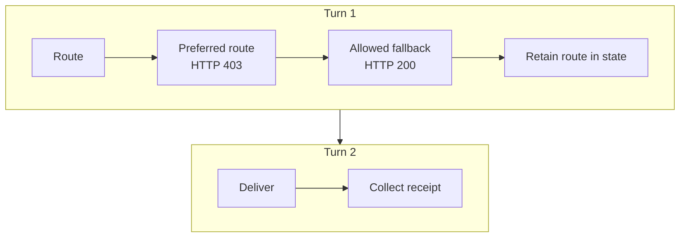

<!--
SPDX-FileCopyrightText: Copyright (c) 2026, NVIDIA CORPORATION & AFFILIATES. All rights reserved.
SPDX-License-Identifier: Apache-2.0
-->

# Run a Stateful LangGraph Agent in OpenShell

Portable Courier is a credential-free NeMo Fabric example. A custom LangGraph
agent and its Fabric adapter run in an OpenShell sandbox; the consumer uses the
normal Fabric SDK and makes no OpenShell API calls.

## Scenario

One runtime handles two turns. The first tries a blocked route, then uses the
allowed fallback. The second uses retained graph state to write a receipt that
the adapter declares and Fabric collects.



The policy permits `GET /` and denies `GET /priority-lane`. The graph observes
the denial, chooses the fallback, then writes `delivery-receipt.json` on turn 2.

## Run

From the repository root, run both ownership modes:

```bash
UV_PROJECT_ENVIRONMENT="$PWD/.tmp/host-stack-tests" \
  bash examples/langgraph_openshell/run-demo.sh
```

Set `OPENSHELL_EXAMPLE_MODE=caller_owned` or `fabric_owned` to run one mode.
The shared [OpenShell guide](../openshell/README.md) covers prerequisites and
the launcher. The [workload hooks](demo.sh) package this agent and select its
policy; the [consumer](consumer/__main__.py) keeps the normal SDK lifecycle.

## What to verify

The output shows one runtime ID for both turns, HTTP 403 then HTTP 200 on the
preferred and fallback routes, retained state, and the collected receipt. In
caller-owned mode the sandbox remains after detach. In Fabric-owned mode,
`release_environment` deletes it. The
[provider architecture](../../environment-providers/openshell/README.md)
describes the component boundaries.
