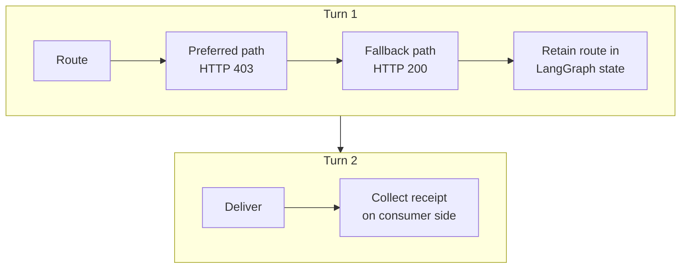

<!--
SPDX-FileCopyrightText: Copyright (c) 2026, NVIDIA CORPORATION & AFFILIATES. All rights reserved.
SPDX-License-Identifier: Apache-2.0
-->

# Run a Stateful LangGraph Agent in OpenShell

Portable Courier is a credential-free end-to-end example of experimental
OpenShell provider support in NVIDIA NeMo Fabric. It runs a custom LangGraph
agent in a real OpenShell sandbox without adding OpenShell-specific logic to
the agent or its Fabric adapter.

For component placement, lifecycle, and ownership, refer to the
[OpenShell environment provider architecture](../../environment-providers/openshell/README.md).

## Scenario

The example sends two inputs to one NeMo Fabric runtime:



The first turn tries `GET /priority-lane`. The OpenShell L7 policy permits only
`GET /`, so the agent observes the denial and selects the allowed fallback.

The second turn uses the retained LangGraph state to write
`delivery-receipt.json`. The adapter declares the file, and NeMo Fabric
collects it through a traversal-safe, size-bounded operation.

## Run the Example

This directory contains the Courier workload. Its entry point runs both the
caller-owned deployment and Fabric-managed development modes by default. To
run only the caller-owned deployment mode:

```bash
OPENSHELL_EXAMPLE_MODE=deployment bash examples/langgraph_openshell/run-demo.sh
```

The [workload hooks](demo.sh) package the existing Courier adapter and graph, select its policy, and invoke the consumer. The [shared launcher](../openshell/README.md) builds the image, provisions OpenShell, and cleans up deployment-owned sandboxes. The consumer retains the normal NeMo Fabric lifecycle; the graph and adapter contain no OpenShell calls.

For another agent, refer to the shared [agent-readiness checklist](../openshell/README.md#agent-readiness). The route/state/receipt assertions in this example are verification, rather than agent requirements.

To run both deployment and Fabric-managed development modes:

```bash
OPENSHELL_EXAMPLE_MODE=both bash examples/langgraph_openshell/run-demo.sh
```

To run only the development mode, use the following command:

```bash
OPENSHELL_EXAMPLE_MODE=development bash examples/langgraph_openshell/run-demo.sh
```

Development mode uses `prepare_environment` to create the sandbox. It verifies
that `release_environment` deletes the Fabric-owned sandbox after the runtime
stops.

## Requirements

Run on Linux with a Linux Docker daemon of the same architecture. Install Rust/Cargo, `uv`, Python 3, `curl`, and `tar`. The [shared setup guide](../openshell/README.md) explains platform checks and the workload interface.

The first run downloads the pinned OpenShell release and builds the agent
runtime image. Later runs reuse the verified release under `.tmp/`.

Set `OPENSHELL_VERSION` to test another published release. Set
`OPENSHELL_EXAMPLE_PORT` if port `18080` is unavailable.

## Expected Evidence

A successful deployment run demonstrates:

- the same NeMo Fabric runtime ID for both turns;
- an HTTP 403 response for the preferred route;
- an HTTP 200 response for the allowed fallback;
- retained LangGraph state during the delivery turn;
- a receipt collected below `.tmp/portable-courier/artifacts/`; and
- a caller-owned sandbox that still exists after NeMo Fabric detaches.

On failure, the script prints the tail of the OpenShell gateway log before
cleaning up its temporary state.

## What This Example Proves

- A custom agent and its Fabric adapter can run unchanged inside OpenShell.
- One NeMo Fabric runtime preserves one ordered, stateful agent session.
- OpenShell, not NeMo Fabric, enforces the sandbox policy.
- The deployment consumer retains sandbox lifecycle and concurrency control.
- NeMo Fabric normalizes invocation results and declared artifacts across the
  sandbox boundary.
