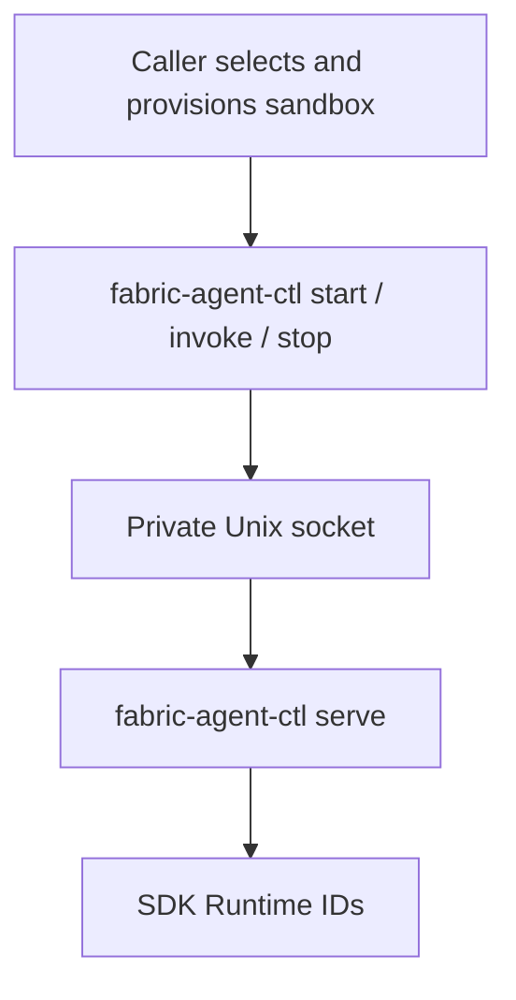

<!--
SPDX-FileCopyrightText: Copyright (c) 2026, NVIDIA CORPORATION & AFFILIATES. All rights reserved.
SPDX-License-Identifier: Apache-2.0
-->

# NVIDIA NeMo Fabric Host And Command Bridge

`fabric-agent-ctl` is installed with `nemo-fabric-runtime`. One foreground `serve` process can own multiple SDK runtime lifecycles inside one sandbox. Short-lived commands connect through a private Unix socket and call the existing public SDK. The caller owns image selection, credentials, mounts, network policy, retained storage, and sandbox deletion.

## Commands

| Command | SDK operation | JSON stdout |
| --- | --- | --- |
| `serve` | Start the foreground runtime server; no agent selection | None |
| `start --agent NAME --config FILE` | `Fabric.start_runtime(config, base_dir=...)` | `RuntimeHandle.to_mapping()` |
| `invoke --agent NAME --runtime-id ID --input FILE` | `Runtime.invoke(input=...)` | Rust SDK `RunResult` JSON schema |
| `invoke --agent NAME --runtime-id ID --request FILE` | `Runtime.invoke(request=RunRequest(...))` | Rust SDK `RunResult` JSON schema |
| `stop --agent NAME --runtime-id ID` | `Runtime.stop()` | `null` |

Run the server under the sandbox supervisor:

```sh
fabric-agent-ctl serve
```

Wait for `/sandbox/fabric.sock` with a caller-owned deadline, then issue commands through separate sandbox exec calls:

```sh
fabric-agent-ctl start --agent researcher --config /sandbox/config.json
fabric-agent-ctl invoke --agent researcher --runtime-id RUNTIME_ID --input /sandbox/input.json
fabric-agent-ctl stop --agent researcher --runtime-id RUNTIME_ID
```

Replace `RUNTIME_ID` with `runtime_id` from the returned SDK handle. Command stdout uses the Rust SDK schemas directly: the start handle, invocation result, and JSON `null` for stop. The private socket envelope stays internal to the bridge. The task-side Python SDK represents telemetry references as a sequence; the bridge preserves zero or one reference in the Rust SDK's optional-reference field and rejects multiple references rather than dropping data. Multiple invocations retain the same runtime and conversation. Targeted commands require both the returned runtime ID and exact agent name. Repeated successful stop is a no-op. Serve starts a process and is never forwarded over the socket.

There are no health commands, generation tokens, fingerprints, state snapshots, or additional SDK lifecycle APIs. Caller-side preflight uses existing `Fabric.plan()` and `Fabric.doctor()`. `Fabric.start_runtime()` validates configuration against installed descriptors before native runtime startup. A configuration rejection before startup does not consume the sandbox lifecycle.

## Multiple Runtimes Per Sandbox

Each successful start creates an independent SDK runtime with its own returned runtime ID. Start, invoke, and stop commands route by both runtime ID and exact agent name. Multiple runtimes can remain active in the same sandbox, and a new runtime can be started after another has stopped. The host serializes SDK operations so concurrent calls do not race the runtime registry or workspace setup.

A configuration rejection before SDK startup has no effects. If start is dispatched but the SDK result is lost or invalid, the host refuses further starts because it cannot identify or own a possible runtime. Failed stops retain their runtime handle for retry. The sandbox ownership marker remains after any start and is cleared only by the enclosing sandbox supervisor after all processes exit.



The outer server is separate from the SDK adapter process and selected harness. It uses the same public `Fabric.start_runtime`, `Runtime.invoke`, and `Runtime.stop` APIs, and preserves the SDK's multiple-runtime behavior. This command bridge currently buffers invocations; streaming and shared-service operations remain available to direct SDK consumers.

Ordinary SDK stop does not establish that all harness descendants exited. A successful stop response reports completion of the SDK operation. The caller must delete the sandbox so the enclosing supervisor handles descendants. The server does not interrupt adapters through a new forced-stop SDK API.

## Transport And Failure Behavior

Successful commands except serve write exactly one newline-terminated SDK JSON value to stdout and exit 0. An invocation returning a failed SDK `RunResult` writes that complete result to stdout and exits 1. Preserve this result even when the exit code is nonzero. SDK exceptions, validation errors, and transport failures leave stdout empty, write a bounded JSON diagnostic to stderr, and exit 1. Server logs also use stderr. Requests are bounded to 512 KiB and responses to 4 MiB, including framing. Calls have a 320-second transport deadline; incomplete input has a ten-second deadline. The caller also bounds OpenShell execution and startup polling.

A timeout or missing, malformed, truncated, or oversized response leaves dispatched effects unknown. Errors use fixed diagnostics with `effects: none`, `applied`, or `unknown`. Routine errors exclude prompts, configuration values, and raw exceptions. Invocation results preserve normalized SDK results, including failed results with null output, and may contain user data. Calls are never replayed after an uncertain outcome.

`--config -`, `--input -`, and `--request -` explicitly select stdin. Otherwise commands read staged regular files containing one bounded UTF-8 JSON value. Config and full-request files must be objects. `--input` accepts the SDK's JSON input values; keys named `stream` or `streaming` remain agent data. `--request` uses the public `RunRequest` schema and preserves request IDs, Relay session roots, context, overrides, and supported extensions. The payload options are mutually exclusive. Unknown or duplicate flags, duplicate JSON keys, non-finite numbers, and oversized input are rejected. Invocation remains buffered.

## Ownership And Shutdown

The default socket is `/sandbox/fabric.sock`, mode `0600`. `FABRIC_HOST_SOCKET` selects another socket path; all callers must use the same path. An exclusive lock on `fabric.lock` prevents a second server from replacing an active socket. The parent directory is the SDK base directory. Missing `tmp`, `workspace`, and `artifacts` directories are created with mode `0700`; existing data remains in place.

The server creates a private `fabric.unclean` ownership marker before accepting requests. After any successful or uncertain runtime start, the marker stays present even after SDK stop and normal server exit. A replacement server reports `cleanup_unconfirmed` instead of starting another runtime. An unused server can remove its own marker on orderly shutdown. With retained storage, clear the marker only after the enclosing supervisor has terminated the previous sandbox's processes.

SIGTERM and SIGINT reject new work. An idle runtime receives ordinary SDK stop. If runtime work is active, shutdown reports `cleanup_unconfirmed` and leaves descendant cleanup to the sandbox supervisor. A four-second process watchdog bounds exit when native worker threads remain active. Failed teardown also preserves the marker. Shutdown removes only the owned socket and preserves caller-owned files.

The bridge requires Unix sockets and `fcntl`; Windows imports remain safe and commands report `platform_unsupported`. The public SDK does not depend on this bridge or OpenShell.

## Local Qualification And Migration

Follow the [OpenShell Code Review instructions](../../../../../../examples/code_review_agent/README.md#openshell-code-review) to build the image and create a sandbox. The image contains the current SDK, host, adapter, and harness, and advertises `fabric-agent-ctl`, interface version 3, and `start/invoke/stop/serve`. Rebuild older images and create fresh sandboxes after this scope change.

The example starts the server, waits for its socket, starts one runtime, invokes twice, and stops through separate exec calls. Add another `start` to create an independent runtime in the same sandbox. The older NemoClaw client using `validate/prepare/configure` requires migration. Version 1 and 2 requests fail explicitly; CLI and server must use the same interface version.
